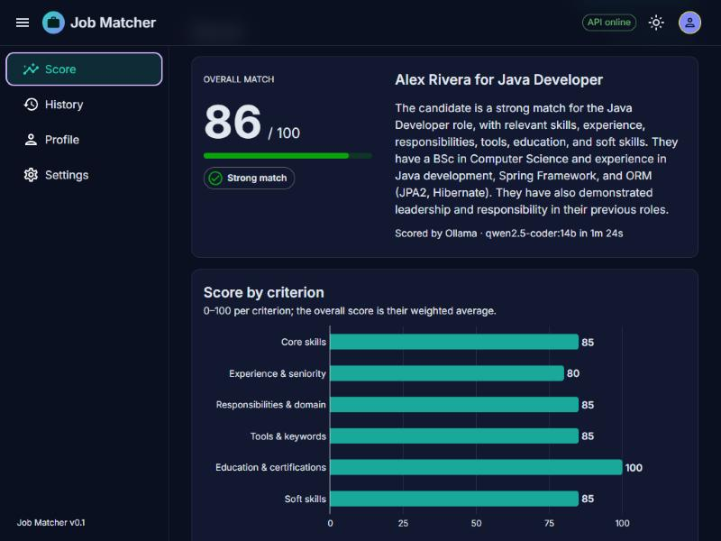
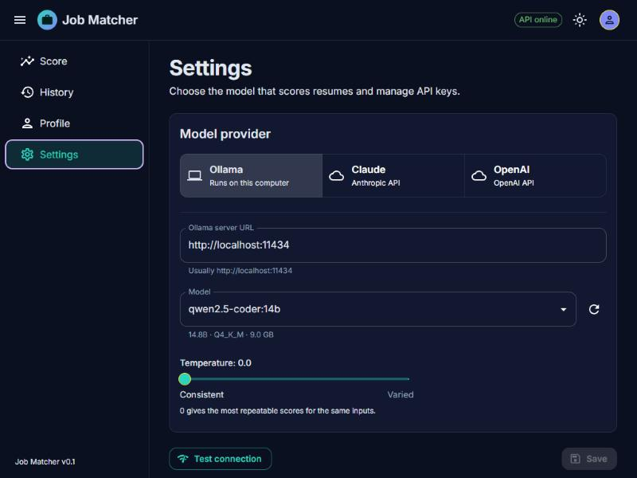
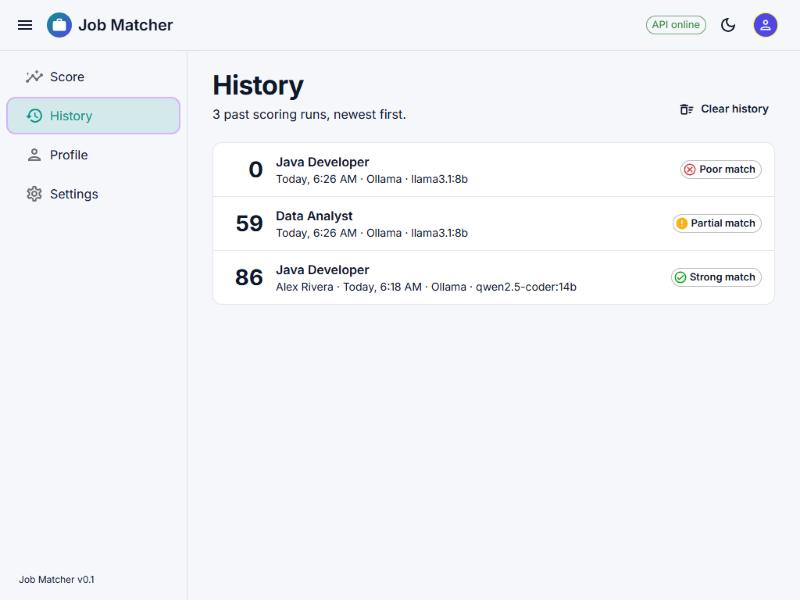

# Job Matcher

Score how well a resume fits a job description, and see why.

Paste or upload a job description and a resume (PDF, DOCX or text). A language model compares them on
six criteria and returns a 0–100 match score, a bar chart of the criteria, the reasoning and evidence
behind each score, and concrete advice. It runs on your own machine with a local model through
[Ollama](https://ollama.com), or with Claude or OpenAI if you add an API key.



## Features

- **Match score with reasons.** Six weighted criteria, each with a score, a short rationale, the evidence
  found in the resume and what is missing. The overall score and verdict (Strong, Good, Partial, Poor
  match) are calculated from them.
- **Honest advice.** "Tailor the resume" suggests better ways to present experience you already have;
  "Skills to build" lists what you would need to learn or earn. The app never tells you to claim
  something you do not have.
- **Upload or paste.** PDF, DOCX and text files up to 5 MB, by button or drag and drop, with warnings
  for scanned PDFs.
- **Your choice of model.** Any model installed in Ollama, or Claude and OpenAI with your own key. Model
  lists, connection test and masked key storage on the Settings page.
- **Profile.** Save a default resume so each score only needs a job description.
- **History.** Every score is saved; reopen, rescore or delete past runs.
- **Dark and light themes**, a collapsible sidebar, and layouts that work on a phone.

| Settings | History |
|---|---|
|  |  |

## Quick start

You need [uv](https://docs.astral.sh/uv/), [Node.js](https://nodejs.org/) 22+ and
[Ollama](https://ollama.com/download).

```bash
ollama pull qwen2.5-coder:14b
```

```bash
cd backend
uv sync
uv run uvicorn app.main:app --reload --port 8000
```

In a second terminal:

```bash
cd frontend
npm install
npm run dev
```

Open **http://localhost:5173**. The full walkthrough, including which model suits your GPU, is in
**[Getting started](docs/getting-started.md)**.

## How scoring works

A LangGraph pipeline makes three model calls: it extracts the job's requirements and the candidate's
profile (in parallel), then scores six criteria against them. The overall score is the weighted average:

| Criterion | Weight |
|---|---|
| Core skills | 30% |
| Experience & seniority | 20% |
| Responsibilities & domain | 20% |
| Tools & keywords | 10% |
| Education & certifications | 10% |
| Soft skills | 10% |

80+ is a strong match, 65–79 good, 45–64 partial, below 45 poor. Diagrams of the pipeline and the rest
of the system are in **[Architecture](docs/architecture.md)**.

## Tech stack

| Layer | Technology |
|---|---|
| Frontend | React 19, TypeScript, MUI 9, MUI X Charts, React Router 8, TanStack Query, Vite |
| Backend | Python 3.12, FastAPI, LangGraph, LangChain (`langchain-ollama`, `langchain-anthropic`, `langchain-openai`) |
| Documents | pypdf, python-docx |
| Storage | SQLite (one local file) |
| Models | Ollama locally; Claude or OpenAI optionally |
| Tooling | uv, pytest, Vitest, Testing Library, oxlint, Prettier |

## Project layout

```text
job-matcher-langchain/
├─ backend/                 FastAPI service (uv project)
│  ├─ app/
│  │  ├─ main.py            app setup and routers
│  │  ├─ api/               HTTP endpoints: score, extract-text, settings, profile, history
│  │  ├─ scoring/           LangGraph pipeline, prompts, schemas and criteria
│  │  ├─ llm/               model selection, model lists, error messages
│  │  ├─ extract/           PDF / DOCX / text extraction
│  │  ├─ store/             SQLite wrapper
│  │  └─ user_settings.py, profile.py, history.py
│  ├─ tests/                pytest suite
│  └─ data/                 jobmatcher.db, created on first run (git-ignored)
├─ frontend/                React app (Vite)
│  └─ src/
│     ├─ pages/             Score, History, Profile, Settings
│     ├─ score/             inputs, progress, results (chart, explanations)
│     ├─ layout/            app bar and sidebar
│     ├─ api/               typed API client
│     └─ theme/             dark and light themes
├─ docs/                    getting started, architecture, screenshots
└─ .claude/launch.json      dev servers for the Claude Code browser preview
```

## Your data and privacy

- Everything is stored in **`backend/data/jobmatcher.db`** on your machine: settings, profile, History
  and any API keys you save. Keys are stored in plain text there and only ever shown masked in the app.
- With Ollama, nothing leaves your machine. With Claude or OpenAI, the job description and resume are
  sent to that provider for scoring.
- The API has no login; it is meant to run locally. See
  [Security and privacy](docs/architecture.md#security-and-privacy).

## Development

```bash
cd backend
uv run pytest
```

```bash
cd frontend
npm test
npm run lint
npm run build
```

More in [Getting started → Development](docs/getting-started.md#development).

## Documentation

- **[Getting started](docs/getting-started.md)**: install, run, first score, settings, configuration,
  troubleshooting.
- **[Architecture](docs/architecture.md)**: system diagrams, the scoring pipeline, data model, API
  reference, design decisions, known limitations.

## License

No license has been chosen yet. Add a `LICENSE` file before publishing or sharing the code.
