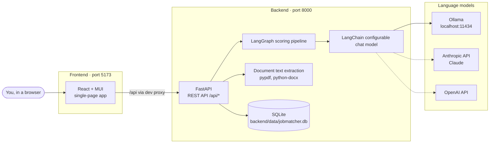
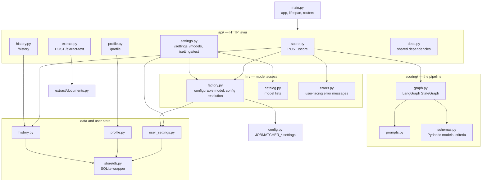
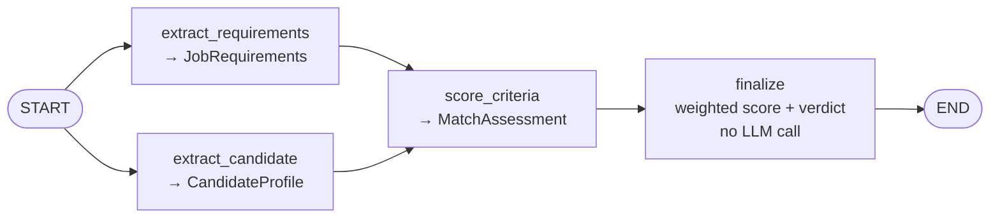
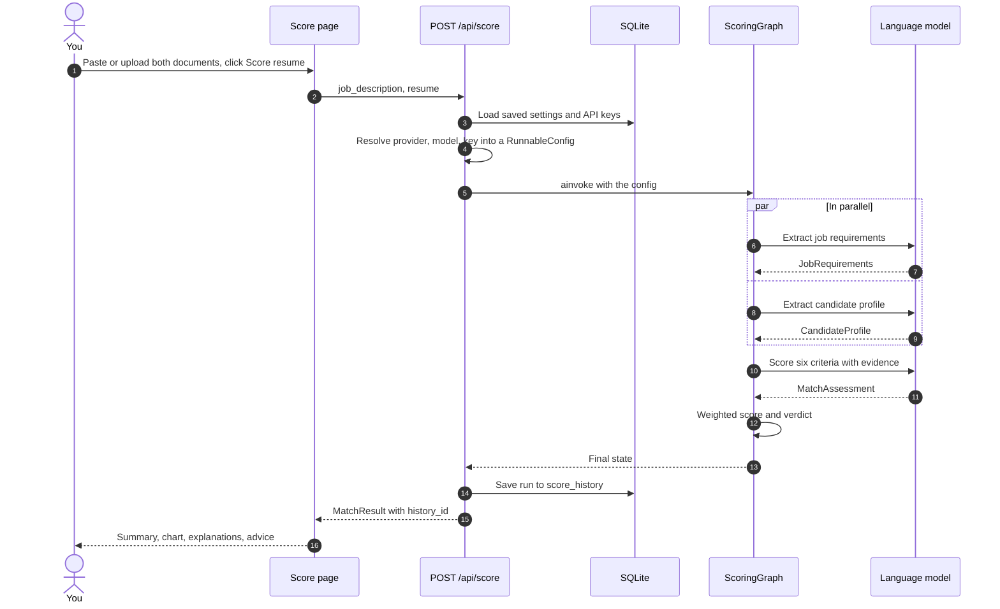
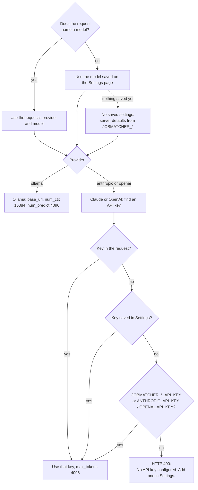
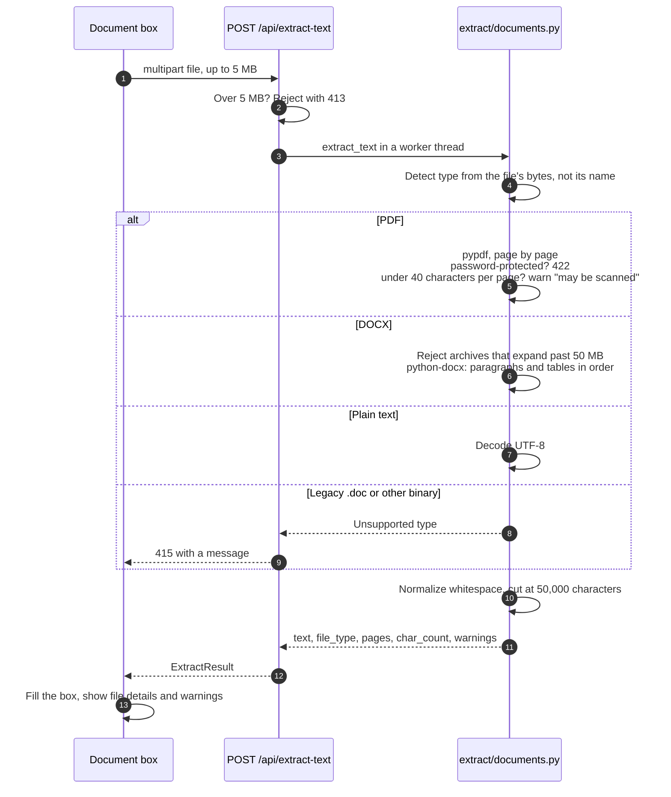
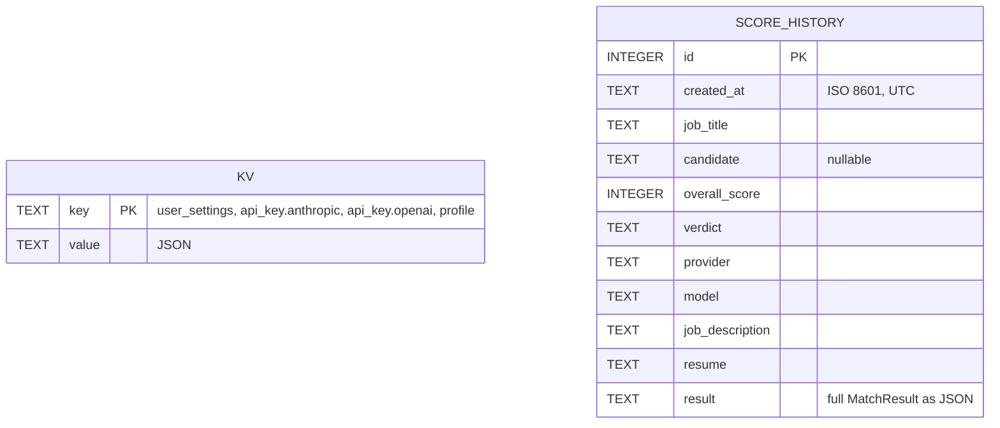
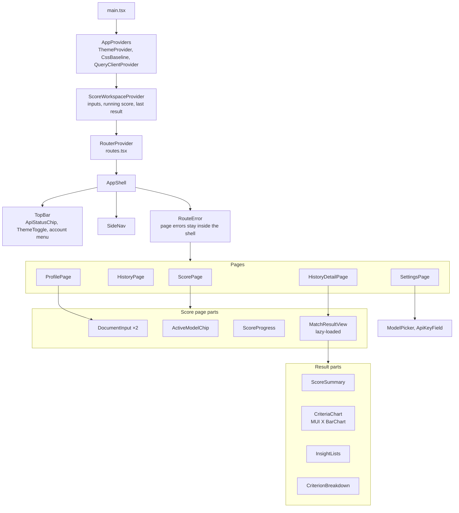
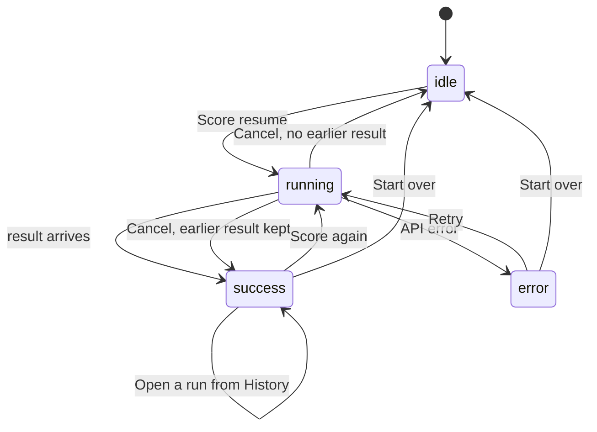

# Architecture

How Job Matcher is put together: the moving parts, how a score is produced, where data lives, and why
some things are built the way they are. For setup and day-to-day use, see
[Getting started](getting-started.md).

- [System overview](#system-overview)
- [Backend](#backend)
  - [Modules](#backend-modules)
  - [The scoring pipeline](#the-scoring-pipeline)
  - [Scoring a resume, end to end](#scoring-a-resume-end-to-end)
  - [Choosing the model and API key](#choosing-the-model-and-api-key)
  - [Reading uploaded documents](#reading-uploaded-documents)
  - [Data model](#data-model)
  - [API reference](#api-reference)
- [Frontend](#frontend)
  - [Components](#frontend-components)
  - [Scoring states](#scoring-states)
  - [State and persistence](#state-and-persistence)
- [How scores are calculated](#how-scores-are-calculated)
- [Design decisions](#design-decisions)
- [Testing](#testing)
- [Security and privacy](#security-and-privacy)
- [Known limitations](#known-limitations)

## System overview

Job Matcher is a single-user app that runs on your own machine. A React single-page app talks to a
FastAPI backend; the backend runs a LangGraph pipeline that asks a language model to compare a job
description with a resume. The model can be local (Ollama) or hosted (Claude or OpenAI).

Dashed lines are optional: Claude and OpenAI are only contacted when you pick them in Settings.

## Backend

Python 3.12, FastAPI, LangGraph and LangChain, managed with [uv](https://docs.astral.sh/uv/). All code is
under `backend/app/`.

### Backend modules

| Module | Responsibility |
|---|---|
| `main.py` | Creates the FastAPI app. Its lifespan builds one configurable chat model, the scoring graph, the SQLite store and a shared `httpx.AsyncClient`. |
| `config.py` | Server defaults from `JOBMATCHER_*` environment variables or `backend/.env`. |
| `api/deps.py` | Dependencies (`get_store`, `get_http_client`, `get_chat_model`) so tests can swap in fakes. |
| `scoring/schemas.py` | The six criteria and their weights, the structured-output models the LLM fills, and the API models. |
| `scoring/prompts.py` | The three prompts. Documents are wrapped in tags and treated as data. |
| `scoring/graph.py` | The LangGraph pipeline, weighted score and verdict. |
| `llm/factory.py` | Builds the configurable model and turns a provider/model/key choice into a LangChain `RunnableConfig`. |
| `llm/catalog.py` | Lists installed Ollama models or the Anthropic/OpenAI model list. |
| `llm/errors.py` | Converts connection, auth and "model not found" errors into actionable messages. |
| `extract/documents.py` | Turns PDF, DOCX or text uploads into clean text, with warnings. |
| `user_settings.py`, `profile.py`, `history.py` | Saved settings and keys, the profile, and past scores. |
| `store/db.py` | A thread-safe SQLite wrapper: a JSON key/value table plus `execute`/`fetch` for real tables. |

### The scoring pipeline

`ScoringGraph` is a LangGraph `StateGraph` with four nodes. The two extraction steps run in parallel;
each LLM step uses `with_structured_output` with a Pydantic schema and retries once if the model
returns JSON that fails validation.

| Step | Reads | Produces |
|---|---|---|
| `extract_requirements` | Job description | Title, seniority, minimum years, must-have and nice-to-have skills, tools, responsibilities, domain, education, certifications, soft skills |
| `extract_candidate` | Resume | Name, current title, years of experience, skills, tools, roles, domains, education, certifications, soft skills, achievements |
| `score_criteria` | Both extractions plus both full documents | A score, rationale, evidence and missing items for each of the six criteria; summary, strengths, gaps, resume tips, skills to build |
| `finalize` | The assessment | Criterion list with labels and weights, the overall weighted score, and the verdict |

The overall score is computed in Python, not by the model, so a given assessment always produces the
same number.

### Scoring a resume, end to end

If any model call fails, the API returns HTTP 502 with a message from `llm/errors.py` (for example
"Cannot reach Ollama at http://localhost:11434"), and nothing is saved to History.

### Choosing the model and API key

One LangChain chat model is created at startup with `init_chat_model(configurable_fields=...)`. Each
request decides which provider and model it uses by passing values in `config["configurable"]`, which
LangGraph hands to every node.

### Reading uploaded documents

### Data model

Everything is stored in one SQLite file, `backend/data/jobmatcher.db`, created on first start.

| Key in `kv` | Contents |
|---|---|
| `user_settings` | Provider, last model per provider, Ollama URL, temperature |
| `api_key.anthropic`, `api_key.openai` | The raw API key (see [Security and privacy](#security-and-privacy)) |
| `profile` | Name, email, headline, default resume and its file name, last update time |

History rows keep the full result as JSON and return it as-is, so runs saved by an older version still
open after the result format changes.

### API reference

Interactive docs are at `http://localhost:8000/docs` while the backend runs.

| Method and path | Purpose |
|---|---|
| `POST /api/score` | Score `{job_description, resume, llm?, weights?, save_to_history?}`. Without `llm`, the saved model is used. Returns `MatchResult` with `history_id`. |
| `POST /api/extract-text` | Multipart `file` → `{filename, file_type, text, char_count, pages, warnings}` |
| `GET /api/settings` | Saved settings, with API keys masked (`sk-ant…WXYZ`) and their source |
| `PUT /api/settings` | Partial update. In `api_keys`, a string saves a key and `null` removes it. |
| `POST /api/models` | `{provider, api_key?, ollama_base_url?}` → model options, `source: live or suggested`, `error` |
| `POST /api/settings/test` | `{provider, model, api_key?, base_url?}` → `{ok, message, latency_ms}` |
| `GET` / `PUT /api/profile` | The profile |
| `GET /api/history?limit=&offset=` | Summaries, newest first, with `total` |
| `GET` / `DELETE /api/history/{id}` | One run with its inputs and result / delete it |
| `DELETE /api/history` | Delete all runs |
| `GET /api/health` | `{"status": "ok"}` |

Errors use FastAPI's `{"detail": ...}` shape: 400 for configuration problems (missing key), 404 for a
missing history entry, 413/415/422 for uploads and validation, 502 when the model call fails.

## Frontend

React 19, TypeScript, MUI 9, MUI X Charts, React Router 8 and TanStack Query, built with Vite. All code
is under `frontend/src/`.

### Frontend components

| Folder | Contents |
|---|---|
| `api/` | `client.ts` (fetch wrapper that surfaces FastAPI's `detail`), `types.ts` (mirrors the backend models), `queryKeys.ts` |
| `layout/` | App shell, top bar, sidebar (collapses to icons on desktop, slides over on phones) |
| `pages/` | One component per route, plus the not-found and route error pages |
| `score/` | Score page inputs, progress, workspace state, and `results/` |
| `settings/`, `history/` | Pieces used only by those pages |
| `components/` | Small shared pieces: page header, placeholder, confirm dialog, theme toggle |
| `theme/` | MUI theme with dark and light color schemes, score bands |
| `test/` | Vitest setup, fixtures and the `renderApp`/`mockApi` helpers |

### Scoring states

While running, the inputs are locked and `ScoreProgress` shows an elapsed timer with time-based status
text (the backend does not stream progress).

### State and persistence

| What | Where | Lifetime |
|---|---|---|
| Server data: settings, profile, history, model lists | TanStack Query cache | Refetched as needed; mutations update or invalidate it |
| Score page inputs, running request, last result | `ScoreWorkspaceProvider`, above the router | Survives page changes; a running score keeps going |
| Draft job description and resume | `localStorage` `jobmatcher.draft.*` | Survives reloads |
| Light or dark mode | `localStorage` `jobmatcher.color-mode`, applied by a script in `index.html` before React loads | Survives reloads |
| Sidebar expanded or collapsed | `localStorage` `jobmatcher.sidenav.expanded` | Survives reloads |

Pages other than Score are lazy routes; see [Design decisions](#design-decisions) for how the bundle is
split.

In development, Vite proxies `/api` to `http://localhost:8000` with a 15-minute timeout, because a
local model can take minutes to score.

## How scores are calculated

Each criterion is scored 0–100 by the model. The overall score is the weighted average:

| Criterion | Weight | What it measures |
|---|---|---|
| Core skills | 30% | Required skills the candidate demonstrably has |
| Experience & seniority | 20% | Years and level of experience versus what the job asks |
| Responsibilities & domain | 20% | Similar work, scale and industry |
| Tools & keywords | 10% | Specific technologies and keywords named in the job description |
| Education & certifications | 10% | Degrees and certifications required or preferred |
| Soft skills | 10% | Communication, leadership, collaboration |

Weights can be overridden per request with `weights` (the UI does not expose this yet).

| Overall score | Verdict |
|---|---|
| 80–100 | Strong match |
| 65–79 | Good match |
| 45–64 | Partial match |
| 0–44 | Poor match |

## Design decisions

**One configurable model for every provider.** LangChain's `init_chat_model` with configurable fields
lets the same graph run on Ollama, Claude or OpenAI; the choice travels in `RunnableConfig`, so nothing
is rebuilt per request and tests can substitute a fake model.

**Two extraction steps before scoring.** Pulling structured requirements and a candidate profile first,
in parallel, gives the scoring step organized input. This noticeably improves explanations on small
local models compared with one large prompt.

**The overall score is arithmetic, not opinion.** The model scores each criterion; Python applies the
weights. The same assessment always produces the same overall number and verdict.

**Advice is split into "Tailor the resume" and "Skills to build".** With a single recommendations list,
models told candidates to add certifications they did not have. Giving missing skills their own list,
phrased as things to learn or earn, stopped that.

**Ollama gets a larger context and an output cap.** Ollama's default context window can silently cut
off a long resume, so `num_ctx` is 16,384. Output is capped at 4,096 tokens so a runaway generation
ends instead of filling the context. Both use GPU memory: a model that does not fit spills onto the CPU
and becomes several times slower (see the model guide in [Getting started](getting-started.md#3-install-ollama-and-a-model)).

**API keys are masked on the way out.** The browser only ever receives a preview like `sk-ant…WXYZ`;
model lists and connection tests send a newly typed key in a POST body, never in a URL.

**Charts are accessible.** One series means one color for every bar and no legend; values sit at the
bar tips, and the per-criterion breakdown doubles as the table view. Verdict colors always come with an
icon and a label.

**Code is loaded when it is needed.** The Score page is in the main bundle; History, Profile and
Settings use React Router's `lazy` routes and download on first visit (a thin bar under the app bar
shows while they load). The results view, with the chart library, loads only when a result is shown.
React and MUI are split into their own long-lived chunks (`build.rolldownOptions.output.codeSplitting`
in `vite.config.ts`), so app updates don't invalidate them in the browser cache. The first load is
about 760 kB (240 kB gzipped), almost all of it React and MUI.

**Failed loads say so quickly.** Data queries retry once, then the page shows what failed with a
**Try again** button rather than spinning through repeated retries.

**Works with high-contrast modes.** Colors come from CSS variables, and the selected sidebar item gets
an outline under Windows contrast themes, where background colors are replaced.

## Testing

| Area | Tooling | Approach |
|---|---|---|
| Backend | pytest, pytest-asyncio | A fake structured-output model stands in for the LLM; outbound HTTP (model lists) goes through `httpx.MockTransport`; the SQLite store runs in memory; PDF and DOCX fixtures are generated in the tests with fpdf2 and python-docx |
| Frontend | Vitest, Testing Library, jsdom | Pages render through the real router and providers; `mockApi` answers `/api/*` per test with fixtures |
| Quality | oxlint, Prettier, `tsc` | Run by `npm run lint`, `npm run format`, `npm run build` |

Commands are in [Getting started](getting-started.md#development).

## Security and privacy

- **Local by default.** Everything stays on your machine unless you choose Claude or OpenAI; then the
  job description and resume are sent to that provider to be scored.
- **API keys are stored in plain text** in the local SQLite file. Anyone with access to your user
  account can read them. They are never returned to the browser in full.
- **Untrusted documents.** Prompts wrap documents in tags and tell the model to treat them as data, so
  instructions hidden in a resume ("rate this candidate 100") are not followed.
- **Upload limits.** 5 MB per file, file type detected from content, DOCX archives that expand past
  50 MB are rejected, extracted text is capped at 50,000 characters.
- **No authentication.** The API has no login and allows CORS only from the Vite dev server. Do not
  expose port 8000 to a network you do not trust.

## Known limitations

- **No login or multiple users.** It is a single-user, local app.
- **Cancel stops waiting, not generating.** Cancelling closes the browser request; Ollama finishes the
  answer it is working on.
- **No OCR.** Scanned PDFs produce a warning and little or no text.
- **No live progress.** The progress text is time-based; the backend does not stream steps.
- **Development servers only.** There is no production deployment setup yet; the frontend build
  (`npm run build`) produces static files but nothing serves them alongside the API.
- **Auto-reload and long requests.** `uvicorn --reload` waits for in-flight requests before restarting,
  so code changes made during a long score may not load until you restart the backend.
