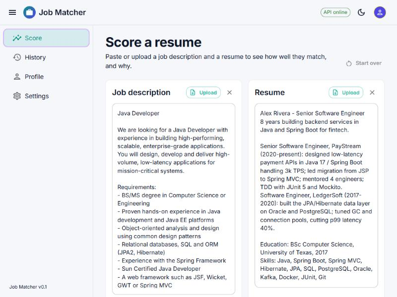
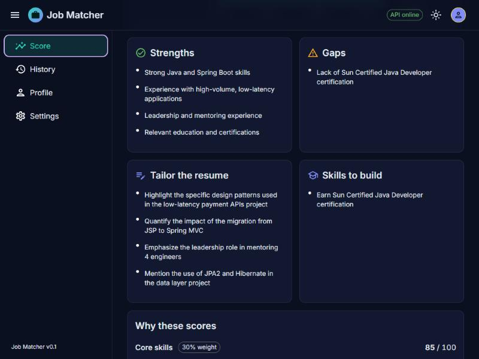

# Getting started

This guide takes you from a fresh copy of the code to scoring your first resume, then covers
configuration, your data, development commands and troubleshooting. For how the app works inside, see
[Architecture](architecture.md).

1. [Prerequisites](#1-prerequisites)
2. [Get the code and install dependencies](#2-get-the-code-and-install-dependencies)
3. [Install Ollama and a model](#3-install-ollama-and-a-model)
4. [Run the app](#4-run-the-app)
5. [Score your first resume](#5-score-your-first-resume)
6. [Choose a model in Settings](#6-choose-a-model-in-settings)
7. [Profile and History](#7-profile-and-history)
8. [Configuration reference](#8-configuration-reference)
9. [Your data](#9-your-data)
10. [Development](#development)
11. [Troubleshooting](#troubleshooting)

## 1. Prerequisites

| Tool | Version | Used for | Install |
|---|---|---|---|
| Git | any | Getting the code | [git-scm.com](https://git-scm.com/downloads) |
| uv | 0.5 or newer | Python 3.12 and the backend's packages; uv downloads Python itself if needed | [docs.astral.sh/uv](https://docs.astral.sh/uv/getting-started/installation/) |
| Node.js | 22 or newer, with npm | The frontend | [nodejs.org](https://nodejs.org/) |
| Ollama | recent | Running models locally (optional if you only use Claude or OpenAI) | [ollama.com/download](https://ollama.com/download) |

Claude or OpenAI are optional. To use them you need an API key from the
[Anthropic Console](https://console.anthropic.com/) or the
[OpenAI platform](https://platform.openai.com/api-keys); using them sends the job description and
resume to that provider.

The commands below work the same in PowerShell on Windows and in a macOS or Linux terminal.

## 2. Get the code and install dependencies

```bash
git clone <your-repository-url> job-matcher-langchain
cd job-matcher-langchain
```

Install the backend (creates `backend/.venv`; downloads Python 3.12 if you do not have it):

```bash
cd backend
uv sync
cd ..
```

Install the frontend:

```bash
cd frontend
npm install
cd ..
```

## 3. Install Ollama and a model

Install Ollama, make sure it is running (on Windows and macOS the app starts it in the background; on
Linux run `ollama serve`), then pull a model:

```bash
ollama pull qwen2.5-coder:14b
```

That is the default model. Pick one that fits your graphics card's memory. When a model does not fit,
part of it runs on the CPU and scoring becomes several times slower.

| Model | Download | GPU memory needed with Job Matcher's settings | Typical time per score | Notes |
|---|---|---|---|---|
| `llama3.1:8b` | 4.9 GB | about 8 GB | 15–60 s | Fastest; explanations are simpler |
| `qwen2.5-coder:14b` | 9.0 GB | about 12–13 GB | 1–2 min | Default; good balance |
| `glm-4.7-flash:q4_K_M` | 19 GB | 20 GB or more | 3–10 min on a 16 GB card | Too large for most single GPUs |

Job Matcher gives Ollama a 16,384-token context window so long resumes are not cut off, which adds a
few GB on top of the download size. To see whether a loaded model fits, run `ollama ps` while scoring:
the `PROCESSOR` column should say `100% GPU`; a CPU/GPU split means it is spilling over.

You can switch models at any time on the Settings page.

## 4. Run the app

You need two terminals, both started from the project folder.

**Terminal 1, the backend** (API on port 8000):

```bash
cd backend
uv run uvicorn app.main:app --reload --port 8000
```

Wait for `Application startup complete.` The first start creates `backend/data/jobmatcher.db`.

**Terminal 2, the frontend** (web app on port 5173):

```bash
cd frontend
npm run dev
```

Open **http://localhost:5173**. The chip in the top-right corner says **API online** when the frontend
can reach the backend.

The backend's interactive API docs are at http://localhost:8000/docs.

> **Using Claude Code?** `.claude/launch.json` defines both servers, so the Claude Code desktop app's
> browser preview can start them for you.

## 5. Score your first resume



1. On the **Score** page, fill in the **Job description** box: paste the text, click **Upload**, or drag
   a PDF, DOCX or text file onto the box (up to 5 MB).
2. Fill in the **Resume** box the same way. After an upload, a chip shows the file name, page count and
   character count, plus any warnings (for example, a scanned PDF with no text).
3. Check the model chip next to the button (for example **Ollama · qwen2.5-coder:14b**). Click it to
   change the model.
4. Click **Score resume**. A progress panel shows elapsed time; you can switch pages or **Cancel**.
5. Read the result:
   - **Overall match**: a 0–100 score with a verdict (Strong, Good, Partial or Poor match) and a summary.
   - **Score by criterion**: a bar chart of the six criteria.


   - **Strengths**, **Gaps**, **Tailor the resume** (ways to present experience you already have) and
     **Skills to build** (what you would need to learn or earn).
   - **Why these scores**: for each criterion, the reasoning, the evidence found in the resume, and
     what is missing.



**Copy report** copies the whole result as Markdown. Your text boxes are kept as drafts, so they survive
a reload; **Start over** clears them.

## 6. Choose a model in Settings


- **Ollama**: set the server URL (normally `http://localhost:11434`), then pick from the models you have
  pulled. Each shows its size and quantization. Use the reload button after `ollama pull`.
- **Claude** or **OpenAI**: paste an API key. It is stored in the local database and only shown masked
  afterwards (`sk-ant…WXYZ`); **Remove** deletes it. With a key, the model list comes from your account;
  without one you see suggested models. If you already set `ANTHROPIC_API_KEY` or `OPENAI_API_KEY`, the
  page shows **From environment** and uses it.
- **Temperature**: 0 gives the most repeatable scores; higher values vary more.
- **Test connection** sends a tiny prompt with what is in the form, before you save.
- **Save** stores the choice. The Score page uses it from then on.

## 7. Profile and History

**Profile.** Add your name, email and headline, and a **default resume**. When the Score page's resume
box is empty, it is filled with your default resume; **Use saved resume** brings it back after you
change it, and **Start over** returns to it. Your initials appear in the top bar.

**History.** Every successful score is saved.


- The list shows each run's score, verdict, job, candidate, time and model, newest first.
- Open a run to see the full result and the original job description and resume.
- **Open in Score page** loads that run back onto the Score page, ready to edit and score again.
- **Delete** removes one run; **Clear history** removes all of them. Both ask first.

## 8. Configuration reference

Most things are set in the app. Server defaults come from environment variables with the prefix
`JOBMATCHER_`, or from a `backend/.env` file:

```bash
# backend/.env
JOBMATCHER_DEFAULT_MODEL=llama3.1:8b
JOBMATCHER_OLLAMA_NUM_CTX=8192
```

| Variable | Default | Meaning |
|---|---|---|
| `JOBMATCHER_DEFAULT_PROVIDER` | `ollama` | Provider before anything is saved in Settings: `ollama`, `anthropic` or `openai` |
| `JOBMATCHER_DEFAULT_MODEL` | `qwen2.5-coder:14b` | Model for that provider before anything is saved |
| `JOBMATCHER_DEFAULT_TEMPERATURE` | `0.0` | Temperature before anything is saved |
| `JOBMATCHER_OLLAMA_BASE_URL` | `http://localhost:11434` | Ollama server before anything is saved |
| `JOBMATCHER_OLLAMA_NUM_CTX` | `16384` | Ollama context window in tokens. Lower it to save GPU memory, at the risk of cutting off long documents |
| `JOBMATCHER_MAX_OUTPUT_TOKENS` | `4096` | Output cap per model call, for every provider |
| `JOBMATCHER_ANTHROPIC_API_KEY` | none | Claude key used when none is saved in Settings |
| `JOBMATCHER_OPENAI_API_KEY` | none | OpenAI key used when none is saved in Settings |
| `JOBMATCHER_DB_PATH` | `data/jobmatcher.db` | SQLite file, relative to `backend/` |
| `JOBMATCHER_CORS_ORIGINS` | `["http://localhost:5173", "http://127.0.0.1:5173"]` | Browser origins allowed to call the API (JSON list) |

Settings saved in the app override the `DEFAULT_*` and `OLLAMA_BASE_URL` values. API keys are looked up
in this order: a key sent with the request, the key saved in Settings, `JOBMATCHER_*_API_KEY`, then the
standard `ANTHROPIC_API_KEY` / `OPENAI_API_KEY`.

The frontend's dev server forwards `/api` to `http://localhost:8000`. To point it elsewhere, set the
`JOBMATCHER_API_URL` environment variable before `npm run dev` (see
[Troubleshooting](#troubleshooting) for the PowerShell and bash syntax).

## 9. Your data

Everything is in one file: **`backend/data/jobmatcher.db`** (SQLite). It holds your settings, saved API
keys (in plain text), your profile and History. Git ignores it.

- **Back up**: stop the backend and copy the file.
- **Start fresh**: stop the backend and delete the file; it is recreated empty on the next start.
- **Remove saved keys only**: use **Remove** on the Settings page.

The browser also keeps your draft text, light/dark choice and sidebar state in its local storage.

## Development

Run from `backend/`:

```bash
uv run pytest
```

Run from `frontend/`:

```bash
npm test
```

```bash
npm run lint
```

```bash
npm run format
```

```bash
npm run build
```

`npm run build` type-checks and writes a production build to `frontend/dist/`. `npm run test:watch`
re-runs tests as you edit.

**After changing backend code, restart the backend if a score was running.** `--reload` waits for
in-flight requests before restarting, so a change made during a long score may not be picked up.

## Troubleshooting

**"API offline" in the top bar.** The backend is not running or not on port 8000. Start it (step 4) and
check its terminal for errors.

**"Cannot reach Ollama at http://localhost:11434".** Start Ollama (open the app, or run `ollama serve`)
and check the URL on the Settings page. **Test connection** confirms it works.

**"Model '…' was not found".** Pull it with `ollama pull <model>` and press the reload button next to
the model list, or pick an installed model.

**Scoring takes many minutes.** The model probably does not fit in GPU memory. Run `ollama ps` while it
works: a `CPU/GPU` split confirms it. Choose a smaller model in Settings (see the table in step 3) or
lower `JOBMATCHER_OLLAMA_NUM_CTX`. If a run seems stuck, **Cancel** stops waiting, but Ollama keeps
generating until it finishes; `ollama stop <model>` or restarting Ollama ends it.

**"No API key configured for anthropic/openai".** Add a key on the Settings page, or switch back to
Ollama. The Score button stays disabled until a key is available.

**"… rejected the API key".** The key is wrong or revoked. Paste a new one in Settings.

**An uploaded PDF gives little or no text.** It is probably a scanned image; Job Matcher does not do OCR.
Paste the text instead.

**"Legacy .doc files are not supported".** Save the file as .docx or PDF and upload that.

**Port 8000 or 5173 is already in use.** Stop the other program, or run the backend on another port
(`--port 8001`) and point the frontend at it before `npm run dev`:
`$env:JOBMATCHER_API_URL = "http://localhost:8001"` in PowerShell, or
`export JOBMATCHER_API_URL=http://localhost:8001` in bash/zsh. Vite picks another free port for the
frontend on its own and prints the URL.

**A blank page after pulling new code.** Stop the frontend dev server and start it again; a stale
module cache can survive hot reloads.

**Colors look different from the screenshots on Windows.** A Windows contrast theme is on
(Settings → Accessibility → Contrast themes). The browser replaces the app's colors with your theme's;
the app stays usable, and the selected sidebar item gets an outline.
